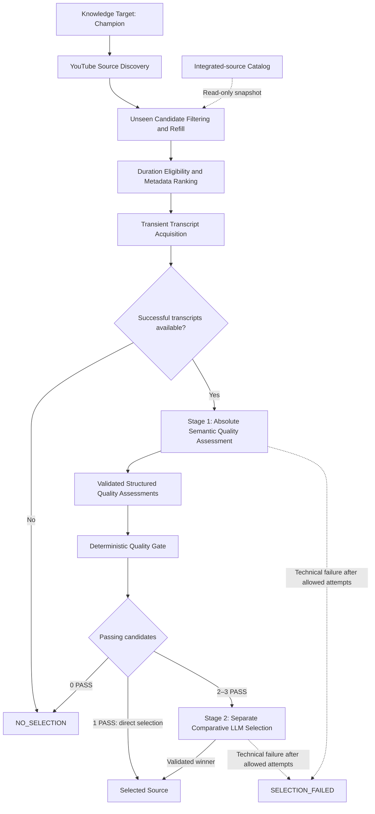
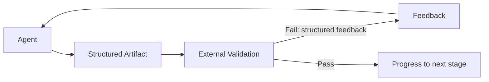

# Agentic Knowledge Preparation for Multi-Hop Retrieval

This project investigates whether query-time latency in agentic multi-hop retrieval can be reduced by shifting part of the knowledge organization upstream into an agentic preparation process.

## Problem

Complex multi-hop questions often require an agent to repeatedly retrieve information and reconstruct relationships between separate pieces of knowledge at query time. This flexibility comes at the cost of increased latency, tool usage and reasoning complexity.

The underlying problem in agentic retrieval over large knowledge bases is therefore not only **how to retrieve relevant information**, but also **how much knowledge organization should happen before a query ever arrives** and **how this knowledge should be organized**.

## Research Question

This project explores whether part of that query-time complexity can be shifted upstream into knowledge preparation.

The core hypothesis is that unstructured source material can be processed in advance through multi-stage agentic knowledge curation and persisted in a more structured, relation-aware representation. For previously unseen multi-hop questions, this may reduce the number of retrieval and reasoning steps required at query time while preserving answer quality.

## Experimental Domain

To investigate this hypothesis, League of Legends was selected as the experimental domain. It provides a complex and continuously evolving body of knowledge with many interconnected concepts, while a large part of the available expertise exists in unstructured public sources such as educational videos.

This makes the domain useful for studying knowledge preparation: relevant information may be distributed across different sources, multiple sources may cover the same Champion or concept, and new sources may add details without replacing what is already known. Multi-hop questions may require connecting Champion mechanics, situational context, and strategic decisions across these sources.

League of Legends therefore serves as the experimental domain rather than the primary technical purpose of the project.

## Approach

The project does not start from a pre-structured knowledge base. Its preparation pipeline is intended to build and evolve knowledge from public unstructured source material, moving some interpretation and relationship-building work upstream. A structured target catalog identifies what to acquire; it is not the knowledge corpus.

The implemented **Source Acquisition** components discover and select source material. **Agentic Knowledge Curation** and **Experimental Evaluation** remain separate planned stages described below. This is not a completed end-to-end acquisition/curation system.

### Data Sources

| Source | Role |
| --- | --- |
| **Riot Games Data Dragon** | Establishes the authoritative Champion target catalog / target universe. The versioned catalog is committed locally and loaded without a runtime Riot request. It is structured target data, not the main knowledge corpus. |
| **YouTube** | V1 public source pool for educational knowledge contained primarily in unstructured video/transcript content. Discovery also supplies structured video metadata used for candidate collection and ranking. |

### Source Acquisition



Stage 1 assesses each available transcript independently against an absolute minimum standard. The flow is **LLM semantic judgement → structured assessment → deterministic application rules → PASS / REJECT**. Application code derives PASS only when `target_relevant`, `educational_substance`, and `transcript_usable` are true and `noise_dominates` is false. The LLM does not return the final gate decision.

Zero passing candidates produces normal `NO_SELECTION`. One is selected directly, without a comparative call. Two or three invoke a separate relative comparison to select the strongest passing source. Stage 2 receives no Stage-1 assessments, booleans, reason codes, or rationales. Neither semantic stage receives popularity, recency, ranking scores, discovery order, or original shortlist rank; explicit request allowlists preserve this boundary.

Selection uses full available transcript text and retains the original candidate identity and segment timing/provenance internally. An empty acquired set produces `NO_SELECTION` without an LLM call. A technical selection failure produces `SELECTION_FAILED`, never a fallback winner or normal no-selection. Technical caption-acquisition failures abort before source selection. Only a successfully selected source is eligible for later Bronze processing; that persistence is not implemented yet.

Automated discovery refers to callable components. Manually initiated resumable-run orchestration and automatic scheduling are not delivered by these components; scheduling remains outside V1.

### Incremental Source Acquisition

Repeated acquisition is intended to find additional previously unseen sources for the same Champion. The integrated-source lookup and filtering are implemented; complete resumable runs, Bronze persistence, and subsequent knowledge integration remain planned. The following conceptual example assumes successful future Bronze persistence and catalog registration after each selected source:

| Logical run | Example |
| --- | --- |
| Run 1 | Source A is selected, then successfully persisted to Bronze and registered as integrated. |
| Run 2 | Integrated Source A is excluded; Source B may be selected and later registered after successful Bronze persistence. |
| Run 3 | Integrated Sources A and B are excluded; Source C may be selected. |

**Selected does not mean integrated.** Discovery, ranking, quality assessment, and selection do not register sources. A later caller registers a source only after successful Bronze persistence. Unselected or rejected candidates are not added to the catalog by acquisition.

An additional source does not necessarily contribute useful new knowledge. Planned curation may create knowledge, enrich existing knowledge, find overlap, flag conflicts, or make `NO_CHANGE`. It will evolve the existing Gold knowledge rather than rebuild an independent knowledge base for every source. Reusable concepts may emerge from Champion sources; systematic concept-target acquisition remains future scope.

## Current Implementation

The repository currently implements Source Acquisition through transient source-selection outcomes:

| Implemented capability | Repository evidence |
| --- | --- |
| Versioned Champion target catalog and local validation/loading | [Catalog](data/champion_targets.json), [target loader](league_knowledge_platform/targets.py) |
| Automated YouTube candidate discovery with metadata and continuation cursors | [Discovery](league_knowledge_platform/youtube.py) |
| Persistent SQLite lookup and idempotent registration of successfully integrated source IDs | [Source catalog](league_knowledge_platform/source_catalog.py) |
| Unseen-source filtering, refill, immutable integrated-ID snapshot, and cross-page deduplication preserving first-seen order | [Collection](league_knowledge_platform/unseen.py) |
| Deterministic popularity/recency ranking, explicit reference time, and configurable duration eligibility through central defaults | [Ranking](league_knowledge_platform/ranking.py), [defaults](league_knowledge_platform/defaults.py) |
| Transient acquisition of timestamped English YouTube captions, manual-English preference, and provider failure handling | [Acquisition](league_knowledge_platform/transcripts.py), [provider adapter](league_knowledge_platform/youtube_caption_provider.py) |
| Absolute semantic quality assessment, deterministic PASS / REJECT, direct or comparative selection, and explicit no-selection/technical-failure outcomes | [Selection service](league_knowledge_platform/source_selection.py), [domain contracts](league_knowledge_platform/selection_models.py) |
| Separate allowlisted semantic requests, configurable DeepSeek adapter, and at most three attempts per semantic stage | [DeepSeek adapter](league_knowledge_platform/deepseek_selection.py), [versioned prompts](league_knowledge_platform/selection_prompts.py) |
| Centralized non-secret service defaults and offline unit/integration tests using fakes and synthetic HTTP fixtures | [Defaults](league_knowledge_platform/defaults.py), [tests](tests/) |

Collection returns at most 20 unique unseen candidates. Duration is an eligibility filter only; popularity and recency determine ranking. The shortlist contains 0–3 candidates. Caption unavailability is candidate-level and non-fatal; technical provider failures fail the operation without returning a successful partial transcript set.

The source catalog capability does **not** mean Bronze persistence exists. Its later integration caller must register a selected source only after successful Bronze persistence. Discovered, ranked, rejected candidates and acquired transcripts are not persisted by these acquisition components.

The platform as a whole remains in development. Bronze/Silver processing, agentic curation, the Deterministic Writer, Gold storage, retrieval indexing, and resumable-run orchestration are planned, not delivered functionality. The fixed-size baseline and comparative evaluation are also not implemented. Implemented selection and its offline tests do not demonstrate live provider availability, semantic model quality, or the research hypothesis.

## Planned Agentic Knowledge Curation

The planned curator has two logical AI stages, **Knowledge Extraction** and **Knowledge Integration**, followed by a **Deterministic Writer**. This explains the intended curation inside the accepted Knowledge Platform architecture; it does not introduce a replacement architecture or claim that these agents already exist.

Its planned flow is **Selected Source → Transcript Processing → Agentic Knowledge Extraction → Existing-Knowledge Inspection → Knowledge Integration → Updated Structured Knowledge Base**. Bronze retains the selected raw source; Silver performs source-faithful transcript processing. External validation gates progression and deterministic code applies approved changes to existing Gold. See the separate [planned curation architecture](docs/architecture.md#knowledge-layers-and-curator).

Knowledge Extraction is planned as:

`SEGMENT → VALIDATE → EXTRACT → VALIDATE → AUDIT/REFINE → VALIDATE → Knowledge Items`

The governing principle is **Agent → Artifact → External Validation → Feedback → Agent**:



Agents produce structured intermediate artifacts. Explicit validators outside the generating agent's decision determine stage pass/fail. Failed validation returns structured feedback for corrective iteration; progression occurs only after validation succeeds. Validation is a control mechanism, not a guarantee of factual correctness.

Knowledge Integration inspects relevant existing Gold knowledge and proposes governed changes while preserving provenance and contradictions. Planned operations are `NO_CHANGE`, `CREATE`, `ENRICH`, `REWRITE`, `MERGE`, `LINK`, and `FLAG_CONFLICT`. The Deterministic Writer applies validated, approved state changes. V1 excludes autonomous destructive deletion. Agent frameworks, artifact schemas, and validator implementations remain future technical design work.

## Experimental Evaluation

The hypothesis remains unproven. The planned experiment compares conventional fixed-size chunking plus retrieval with agentically prepared, more structured knowledge. Both paths will use the **same source material** and the **same previously unseen multi-hop questions**. Neither approach is assumed to outperform the other.

The fixed-size chunking baseline still needs to be implemented. Query-time comparison and full evaluation also follow later; neither is implemented yet.

| Planned evaluation category | Dimensions |
| --- | --- |
| Answer quality | Correctness, completeness, groundedness, answer relevance |
| Retrieval quality | Relevant-information recall, retrieval precision, source coverage |
| Query-time efficiency | End-to-end latency, retrieval calls, tool calls, reasoning steps |
| Knowledge preparation | Preparation cost, agent iterations, validation failures, knowledge changes per source, marginal knowledge gain |

The central evaluation question is: **Does additional work during knowledge preparation reduce query-time complexity and latency without sacrificing answer quality?** No comparative results or latency reduction have yet been demonstrated. The [conceptual evaluation diagram](docs/architecture.md#planned-comparative-evaluation) supplements the existing architecture.

## Architecture Principles

- **Local-first V1:** Local artifacts and stores, with external source/search and LLM APIs where required. Azure remains a possible future deployment target.
- **Traceable medallion layers:** Planned Bronze retains selected raw sources; Silver remains source-faithful; Gold is the canonical, adaptive Markdown Knowledge Wiki with provenance and visible contradictions.
- **Derived retrieval:** The planned local retrieval index is derived from Gold and synchronized incrementally. A relation-aware representation does not require a new graph database or fixed Gold ontology.
- **Controlled integration:** Transient candidates remain unpersisted; planned curation validates proposed changes before deterministic application.
- **Human-supervised development:** Versioned plans, human design approval, validation, and human PR review/merge follow the [development workflow](docs/development-workflow.md).

See [V1 scope](docs/scope.md), [architecture](docs/architecture.md), and the [architecture decisions](docs/adr/001-medallion-architecture.md) for the accepted design and its history.

## Roadmap / Status

| Status | Work |
| --- | --- |
| Implemented | Champion targets, discovery, integrated-source lookup, unseen collection, ranking, transient transcripts, absolute quality assessment, deterministic gating, and conditional comparative selection with offline tests |
| In development | Knowledge Platform overall; acquisition components exist, but the full acquisition/curation pipeline is incomplete |
| Planned next | Selected-source Bronze and source-faithful Silver processing |
| Planned subsequent | Validated agentic curation, Deterministic Writer, canonical Gold, incremental retrieval index, resumable runs, and raw knowledge-change metrics |
| Planned evaluation | Fixed-size baseline, query-time comparison, and quality/efficiency/preparation measurements |

The accepted V1 design calls for manually initiated, resumable runs across the Champion catalog, integrating at most one newly selected source per target per logical run. No Champion is permanently complete. Role-specific and reusable knowledge may emerge from sources; a Champion × Role matrix is not required. Dedicated Matchup targets and persistent cross-game user memory remain outside initial V1 scope. A separate League AI Coach may later consume the prepared knowledge.

## Usage and Development

The following APIs are implemented acquisition components. The examples perform live source access only where explicitly indicated; offline tests use injected responses.

## Champion target loading and YouTube discovery

The committed `data/champion_targets.json` catalog is loaded locally with `load_targets()`. Loading validates the complete catalog and raises `TargetLoadError` if it cannot be used. No Riot request is needed at runtime.

Set `YOUTUBE_API_KEY` in the environment before discovery. Keep the key out of repository files and logs. Python 3.10 or newer is required. The discovery API returns one search page per call, including normalized video metadata and a target-bound continuation cursor:

```python
from league_knowledge_platform import YouTubeDiscovery, load_targets

target = load_targets()[0]
discovery = YouTubeDiscovery()
page = discovery.discover_page(target)
# A caller may pass page.next_cursor to discover_page for a later page.
```

Each page enriches its search results with available video metadata. Missing optional fields remain `None`; an upstream failure raises `DiscoveryError` rather than returning a successful page. The separate collector below filters integrated sources and decides whether to request another page. Ranking and transcript evaluation remain outside the discovery and collection components.

## Local source catalog and unseen collection

The source catalog stores only globally integrated YouTube video IDs. A selected source qualifies as integrated after its raw material has been successfully persisted to Bronze. Discovery, collection, ranking, and rejection do not register sources. The later Bronze integration caller must invoke `catalog.register_integrated(video_id)` only after persistence succeeds; repeating that registration is safe and preserves the first registration timestamp. The catalog does not perform or verify Bronze writes itself.

Use SQLite 3.24 or newer with Python's standard-library `sqlite3`. Explicit initialization creates schema version 1; construction and reads never create or migrate a catalog. The database path is caller-controlled; `.state/knowledge_platform.sqlite3` is a suggested local path excluded from Git.

```python
from pathlib import Path
from league_knowledge_platform import (
    YouTubeDiscovery,
    collect_unseen_candidates,
    initialize_source_catalog,
    load_targets,
)

# Explicit setup, separate from read-only collection.
catalog = initialize_source_catalog(Path(".state/knowledge_platform.sqlite3"))
target = load_targets()[0]
result = collect_unseen_candidates(
    target,
    discovery=YouTubeDiscovery(),  # Requires YOUTUBE_API_KEY; performs live discovery.
    catalog_reader=catalog,
)
# result is the input for deterministic ranking, not an ingestion decision.
```

Each collection reads one immutable integrated-ID snapshot before requesting its first page. It excludes integrated IDs, deduplicates across all fetched pages, retains the first candidate's metadata and discovery order, and stops at 20 unique unseen candidates. Overflow is discarded in discovery order. Empty, duplicate-only, or fully integrated pages still trigger refill when a continuation cursor exists. No heuristic page limit or quality threshold is applied.

`UnseenCandidateSet` contains `target_id`, an immutable `candidates` tuple, and `exhausted`; `target_reached` indicates exactly 20 candidates. Normal search exhaustion returns any smaller available set, including an empty set, successfully. Exhaustion means the last successful page had no continuation; it can also be true when the target of 20 is reached.

A discovery failure, including on a later refill page, raises `UnseenCollectionError` rather than returning a successful partial pool. Its `kind`, optional `discovery_failure_kind`, and exception cause distinguish discovery, catalog, and contract failures. Collection does not retry discovery automatically, initialize missing databases, register candidates, or write any persistent state. Missing/corrupt catalogs and unsupported schema versions fail explicitly.

The snapshot is fixed for one collection; it is not a reservation against concurrent source integration. Registration uses short atomic SQL transactions and an idempotent video-ID primary key. Coordinating parallel integrations and recovering between Bronze writes and catalog registration belong to later orchestration. Ranking, transcripts, source selection, Bronze/Silver/Gold processing, run state, and scheduling are not implemented by this collector.

Run offline tests with `python -m unittest discover -s tests -v`. They use injected responses and require neither a YouTube key nor network access.

## Deterministic candidate ranking

`rank_candidates()` consumes a completed `UnseenCandidateSet` and returns an immutable `RankedCandidateSet`. Known durations below 3 minutes or above 30 minutes are excluded before ranking; both boundaries are eligible. Unknown duration remains eligible. Duration has no score contribution: a 10-minute and a 25-minute video with otherwise identical ranking metadata receive identical scores.

```python
from datetime import datetime, timezone
from league_knowledge_platform import rank_candidates

# Use one explicit reference time for reproducible evaluation of this collection.
reference_time = datetime(2026, 10, 13, tzinfo=timezone.utc)
shortlist = rank_candidates(result, reference_time=reference_time)
for entry in shortlist.candidates:
    original_video = entry.candidate
    print(original_video.video_id, entry.score)
```

For eligible candidates, popularity is `ln(1 + views) / ln(1 + maximum eligible views)`. All known counts being zero yields zero popularity. Recency is `2 ** (-age_days / 365)`, where age is calculated against the supplied timezone-aware reference time and capped at zero for a future publication date. Reference times are normalized to UTC; a reference time without a timezone is rejected.

The score is 70% popularity plus 30% recency, rounded to 12 decimal places. Missing views or publication dates remain absent and contribute zero; the other signal's weight is not increased. Equal final scores preserve the original collection/discovery order. This is a metadata funnel, not a judgment of educational or semantic quality.

The output contains exactly `min(3, eligible_count)` entries, including none when every video is excluded. Each entry retains the original `CandidateVideo` object, discovery index, both normalized signals, their contributions, and final score. The set records the UTC reference time, immutable scoring configuration, input and eligible counts, and `input_exhausted` from collection. An empty shortlist does not imply search exhaustion or cause discovery/refill. The ranker makes no network, filesystem, or database calls, and does not register sources or persist candidates. Transcript acquisition and semantic source selection are separate downstream components, described below.

Non-secret tunable defaults are centrally discoverable in `league_knowledge_platform/defaults.py`: duration bounds, Top-K, scoring weights, recency half-life, score precision, the existing unseen limit, and discovery page size/timeout. `RankingConfig` consumes the scoring defaults and can be supplied explicitly for reproducible evaluation; it requires positive weights summing to one with popularity stronger than recency. Eligibility limits and Top-K come from the central service defaults. Existing discovery settings retain their established values and override behavior. Secrets such as `YOUTUBE_API_KEY` remain environment/runtime configuration and never belong in the defaults module.

## Transient English caption acquisition

Install the optional provider dependencies in your Python environment:

```shell
python -m pip install -r requirements-transcripts.txt
```

`acquire_transcripts()` consumes the completed `RankedCandidateSet` without changing ranking, identity, metadata, or relative order. It uses our replaceable `CaptionProvider` protocol. `YouTubeCaptionProvider` wraps the pinned `youtube-transcript-api==1.2.4` public SDK and retrieves existing public caption tracks without a YouTube Data API key. It does not translate captions, download audio, or run speech recognition.

```python
from league_knowledge_platform import YouTubeCaptionProvider, acquire_transcripts

# This explicitly performs live caption requests for the supplied shortlist.
# Offline tests inject a fake provider or synthetic HTTP adapter instead.
with YouTubeCaptionProvider() as provider:
    transcripts = acquire_transcripts(shortlist, provider=provider)

for outcome in transcripts.outcomes:
    print(outcome.ranked_candidate.candidate.video_id, outcome.status.value)
# transcripts.transcripts contains only successful transient acquisitions.
```

Manual English captions are preferred over auto-generated English captions across all accepted English locales. Within each caption type the stable preference is `en`, `en-US`, `en-GB`, then other English variants. Matching is case-insensitive and accepts `_` as a locale separator; original language metadata is retained. A valid but empty manual track may fall back to another existing English track. A technical manual-track failure aborts acquisition rather than being hidden by an automatic-track fallback.

Each acquired transcript references the original `RankedCandidate` and retains ordered segments with source position, decoded source text, whitespace-normalized text, and exact `Decimal` start/duration seconds. Empty segments may be removed; substantive content, repeated captions, overlapping times, and explicit zero duration are preserved. Text is not summarized, semantically cleaned, or truncated for model context. The derived `text` property joins normalized segments without replacing their timing/provenance representation.

The SDK adapter uses public `list()` and track `fetch()` interfaces. A narrowly scoped response hook checks source timing before the SDK can replace a missing duration with zero. It cross-checks the public fetch result against the source response; unsupported caption structures or unexpected text/timing transformations fail explicitly. It does not construct caption URLs, parse YouTube pages, or call private SDK parser functions.

For 0–3 input candidates, `TransientTranscriptSet` retains the original shortlist and an explicit `acquired` or `unavailable` outcome for every candidate. No tracks, disabled captions, no acceptable English track, and valid empty caption content are normal unavailability. Acquisition continues, and successful transcripts retain their original relative order: A acquired, B unavailable, C acquired returns A then C. An empty shortlist makes no provider call; all normally unavailable candidates produce a successful empty transcript tuple with their outcomes.

Timeout, network, rate-limit/blocking, applicable authentication/authorization, service, parsing, malformed/incomplete response, and provider-contract errors raise `TranscriptAcquisitionError`. Its `kind`, `video_id`, `shortlist_position`, and `phase` identify the failure without transcript content or provider URLs. Processing stops, and earlier transcripts are never returned as a successful partial set. General SDK retrieval errors are not classified as normal absence.

Caption responses and transcripts remain in memory. There are no transcript files, persistent caches, Bronze writes, or source-catalog mutations. The caller owns the successful result until downstream source comparison is complete; the provider context closes its HTTP session and clears its track handles. Only a later selected winner may enter Bronze through a separate integration stage. Transcript acquisition does not select a winner, invoke an LLM, rediscover sources, refill, or change ranking.

`TranscriptConfig` consumes centralized non-secret defaults: 5-second HTTP connect timeout and 15-second read timeout. Requests are sequential, with no automatic retry of technical failures. These HTTP timeouts do not promise a fixed overall operation duration. Secrets remain environment/runtime configuration, never defaults. The SDK relies on YouTube web interfaces that can change or block requests; offline validation verifies behavior and integration contracts, not live availability.

Run the full offline suite after installing the optional dependencies:

```shell
python -m unittest discover -s tests -v
```

The real SDK tests use synthetic responses through the public HTTP adapter boundary and never fall back to live YouTube. Without the optional dependencies, SDK adapter tests explicitly skip; the existing components and fake-provider acquisition tests remain available. Synthetic fixture text is test data, not persisted acquired candidate content.

## Source quality assessment and selection

`select_source(target, transcripts, capability=...)` consumes a successful `TransientTranscriptSet` and an explicit `ChampionTarget`. `SourceSelectionCapability` separates absolute quality assessment from comparative selection. `DeepSeekSelectionAdapter` is the concrete V1 provider; install its optional HTTP dependencies with `python -m pip install -r requirements-selection.txt`.

Provide `DEEPSEEK_API_KEY` through the environment or explicit runtime injection. `DEEPSEEK_MODEL` may override the central default model; an explicit `DeepSeekSelectionConfig` is also supported. Secrets never belong in defaults. The adapter uses non-thinking inference, temperature 0, JSON output, bounded response sizes, and local schema validation. These settings do not guarantee deterministic or correct semantic judgments.

| Result | Meaning |
| --- | --- |
| `SelectedSource` / `SELECTED` | Exactly one passing source, with the original transcript, identity, timing, gate results, and comparison artifact when applicable. |
| `NoSelection` / `NO_SELECTION` | No acquired transcripts or a completed quality gate that rejected every candidate. |
| `SelectionFailed` / `SELECTION_FAILED` | Technical/model failure prevented selection; no winner is returned. |

The selection service owns retries: at most three total attempts per semantic stage reuse unchanged inputs. A comparative-stage failure does not repeat successful quality assessment or restart discovery, collection, ranking, or transcript acquisition. The outputs and assessments remain transient, with no Bronze writes or source-catalog mutation. Offline domain, synthetic HTTP, and ranker/caption/selection integration tests are included in the existing test command. Installing both optional requirements files includes the caption and selection adapter coverage; without their respective dependencies, those adapter tests explicitly skip.
