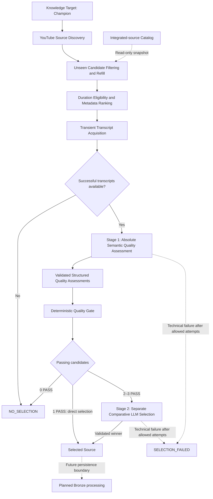
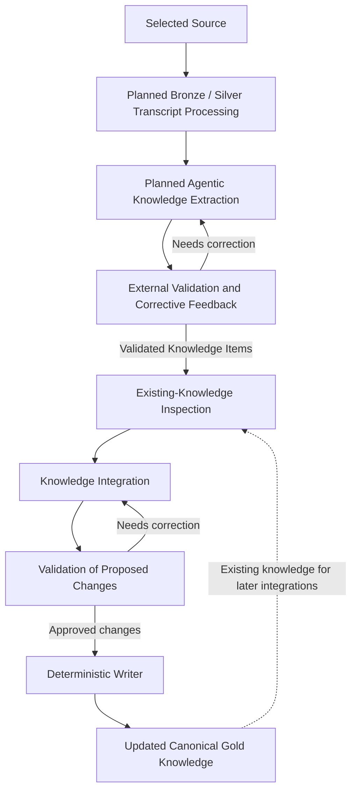
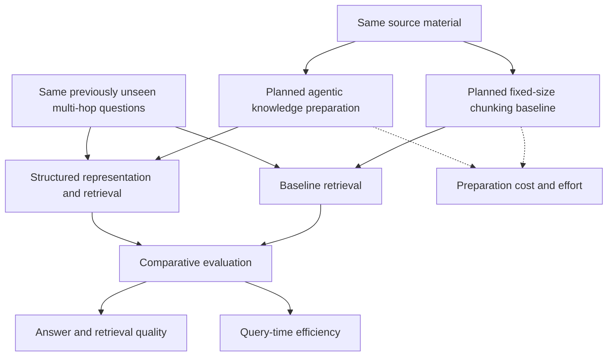

# Architecture

The Knowledge Platform is the acquisition and preparation side of an experiment on whether upstream agentic knowledge organization can reduce later multi-hop retrieval complexity and latency while preserving answer quality. League of Legends is the experimental domain. The hypothesis is unproven; the planned experiment supplements the accepted architecture below.

## V1 acquisition and compilation flow

The architecture has three separate views. Source Acquisition is implemented through transient selection outcomes; the downstream curation and comparative experiment remain planned. These views preserve the existing Bronze/Silver/Gold responsibilities and local-first design.

| View | Current status |
| --- | --- |
| [Source Acquisition](#source-acquisition) | Implemented target loading, discovery, integrated-ID lookup, filtering/refill, metadata ranking, transient transcripts, absolute quality assessment, deterministic gating, and conditional comparison |
| [Agentic Knowledge Curation](#knowledge-layers-and-curator) | Planned Bronze/Silver processing, extraction, external validation, existing-knowledge inspection, integration, deterministic writing, and Gold |
| [Experimental Evaluation](#planned-comparative-evaluation) | Planned fixed-size baseline and quality/query-time-efficiency comparison |

Manually initiated resumable-run orchestration remains planned. The implemented SQLite catalog covers integrated IDs, not all future operational SQL responsibilities. The platform is not yet a completed end-to-end acquisition/curation system.

## Source Acquisition

Riot Games Data Dragon establishes the authoritative Champion target universe through a committed, versioned local catalog; target loading needs no runtime Riot request. YouTube supplies the public V1 educational source pool. Its video/transcript content contains the unstructured source knowledge; discovery metadata supports candidate collection and ranking. The target catalog is not a pre-structured knowledge base.

The initial target catalog lists all Champions without enumerating Champion × Role combinations. Planned run orchestration will attempt every configured target, resume across batches/sessions, and integrate at most one new selected source per target per logical run. A Champion is never permanently complete. Role-specific and reusable general knowledge can emerge from content; systematic general-concept acquisition remains future scope.

For each target, collection seeks 20 unique unseen candidates and returns at most 20, refilling after integrated-ID filtering and cross-page deduplication until enough are found or search is exhausted. Recording exhaustion within a resumable run is planned. Duration is an eligibility filter only; popularity/recency ranking returns up to three candidates. Available English transcripts are acquired transiently, retaining original candidate identity and segment timing/provenance. Technical transcript-acquisition errors abort before source selection; normal absence can yield an empty acquired set.

The implemented semantic stages are separate capabilities behind a provider-independent interface, with a DeepSeek adapter. Explicit allowlists serialize only target ID/name and video IDs/full transcript texts in canonical video-ID order. Neither stage receives popularity, recency, ranking scores, discovery order, channel popularity, or original shortlist rank. Both use complete available transcripts without silent truncation, summarization, or semantic pre-filtering.

**Stage 1 — absolute assessment:** Each transcript is assessed independently for target relevance, educational substance, usability, and whether noise dominates. Validated structured attributes enter application code. The rule is `target_relevant AND educational_substance AND transcript_usable AND NOT noise_dominates`. Thus **LLM semantic judgement → structured assessment → deterministic application rules → PASS / REJECT**. Semantic judgments themselves are not guaranteed deterministic or correct.

**Branching:** Zero acquired transcripts produces normal `NO_SELECTION` without an LLM call. After the quality gate, zero PASS also produces `NO_SELECTION`; one PASS selects that source directly; two or three PASS invoke Stage 2.

**Stage 2 — relative comparison:** Only passing transcripts are compared for target relevance, educational usefulness, information density, clarity/explanatory value, useful breadth/depth, and noise. Fresh request objects and messages exclude Stage-1 assessments, booleans, codes, and rationales. The chosen ID and complete assessment coverage are validated against the passing set. No weighted numeric formula is introduced.

Each semantic stage permits at most three total attempts for recoverable failures or invalid output, reusing unchanged inputs. Unrecoverable errors fail explicitly without consuming unnecessary retries. Technical inability to complete selection yields `SELECTION_FAILED`, not `NO_SELECTION` or a fallback winner. A Stage-2 failure does not repeat successful quality assessment or restart acquisition. All results, assessments, and transcripts remain transient. Only `SELECTED` is eligible for the planned Bronze stage; it does not itself persist or register a source. See the [selection API overview](../README.md#source-quality-assessment-and-selection).

## Knowledge layers and curator

These layers and curator responsibilities are planned. The intended curator comprises logical Knowledge Extraction and Knowledge Integration stages followed by a Deterministic Writer. Extraction progresses through SEGMENT, VALIDATE, EXTRACT, VALIDATE, AUDIT/REFINE, and VALIDATE to Knowledge Items. Structured artifacts pass explicit validation gates; failures return corrective feedback to the agent before progression. Integration inspects existing Gold and proposes governed changes; deterministic code applies validated, approved changes. This staged explanation preserves the existing curator boundary and does not establish a new runtime implementation or artifact schema. See [planned curation](../README.md#planned-agentic-knowledge-curation).

| Component | Responsibility | Durable output |
| --- | --- | --- |
| Bronze | Retain only the admitted source's raw transcript and available provenance. | Selected source material and source identity. |
| Silver | Remove reliably identifiable noise, clean and segment faithfully, and retain timestamps and deterministic provenance. | Source-aligned logical sections without synthesized knowledge or semantic chunk labels. |
| Knowledge Curator | Process one Silver source at a time after inspecting relevant existing Gold knowledge. | Governed changes or a recorded no-change outcome. |
| Gold | Maintain current structured League knowledge in an adaptive, versioned Markdown Knowledge Wiki. | Canonical knowledge with provenance and visible contradictions. |

The curator may apply NO_CHANGE, ENRICH, REWRITE, CREATE, MERGE, LINK, or FLAG_CONFLICT. It favors enriching equivalent knowledge over duplication and does not autonomously DELETE knowledge in V1. Source and operational metadata in Bronze and Silver remain deterministic; this restriction does not prevent semantic knowledge in Gold or transcript-based LLM source selection.

## Local state and retrieval boundary

The implemented SQLite catalog stores only integrated source IDs and their registration timestamps. Registration is idempotent and must follow successful Bronze persistence by a later caller; it does not implement Bronze itself. Collection reads a fixed integrated-ID snapshot and does not persist transient candidates.

**Selected and integrated are distinct states.** A selected source is not registered until a later caller successfully persists it to Bronze. In the intended repeated-run flow, successful persistence/registration of A allows later collection to exclude A and seek B for the same Champion; after B is also integrated, another collection excludes both while seeking C. Run orchestration and those Bronze writes are planned. Rejected or losing candidates are not registered by acquisition.

Additional sources may create or enrich knowledge, overlap with existing knowledge, expose conflicts, or yield `NO_CHANGE` in planned curation. Gold evolves through governed integration with existing knowledge rather than a separate rebuild for every source. These are intended integration outcomes, not implemented curation or guaranteed marginal knowledge gain.

The planned wider local SQL store tracks logical runs and progress, per-target results, raw knowledge-change counts, and Gold index synchronization state. Raw counts will support comparison of marginal knowledge gain across repeated runs; V1 has no synthetic aggregate score or automatic stop threshold. Schemas for those additional responsibilities remain future technical design work.

The planned local retrieval/vector index serves the Gold Wiki but is not authoritative. Changed Gold documents are re-chunked and re-embedded, their vectors are upserted, stale vectors are removed where applicable, and synchronization state is updated. A full rebuild after each curation run is not required. No vector database product is mandated.

The V1 design runs locally with filesystem Bronze/Silver/Gold artifacts and local operational and retrieval stores. External source/search and LLM APIs are used where needed. Azure infrastructure and Azure AI Search are not V1 requirements; Azure remains a possible later deployment direction.

## Planned comparative evaluation

The experiment will compare conventional fixed-size chunking plus retrieval with agentic preparation of more structured knowledge. Both paths will use the same source material and the same previously unseen multi-hop questions. The baseline, query-time comparison, and full evaluation are not implemented. This conceptual diagram supplements the acquisition and compilation architecture; it does not replace it or imply that either approach wins.

The evaluation will ask whether additional preparation reduces query-time complexity and latency without sacrificing answer quality. Planned dimensions include answer correctness, completeness, groundedness and relevance; retrieval recall, precision and source coverage; latency, retrieval/tool calls and reasoning steps; and preparation cost, agent iterations, validation failures, knowledge changes per source and marginal knowledge gain. These are intended measurements, not completed results or a defined benchmark protocol. See the [evaluation overview](../README.md#experimental-evaluation).

## System context and decisions

The separate Voice Coach can later retrieve Gold knowledge and reason over the player's manually supplied game context while maintaining current-game session state. A separate evaluation system can assess retrieval and coaching quality as well as repeated-run knowledge gain. Automatic patch awareness, live game-state reading, and persistent cross-game memory are outside initial V1.

The decisions and superseded assumptions are recorded in the public ADRs: [medallion layers](adr/001-medallion-architecture.md), [Silver source alignment](adr/002-source-aligned-chunks.md), [superseded Azure index](adr/003-single-search-index.md), [source metadata](adr/004-minimal-deterministic-metadata.md), [local-first V1](adr/005-local-first-v1.md), [iterative acquisition](adr/006-iterative-champion-acquisition.md), [source selection](adr/007-two-stage-source-selection.md), [canonical Gold](adr/008-canonical-gold-wiki.md), [operational state](adr/009-local-state-and-knowledge-gain.md), and [incremental retrieval](adr/010-incremental-gold-retrieval-index.md).

The source-selection ADR records the metadata-to-semantic funnel. The semantic portion now has its own absolute-assessment and conditional comparative stages, detailed above. The ADR history remains intact; these details do not replace its acquisition, provenance, or selected-source boundaries.
