# Architecture

## V1 acquisition and compilation flow

```mermaid
flowchart LR
    A["Versioned Champion target catalog"] --> B["Manually initiated, resumable run"]
    B --> C["YouTube candidate discovery"]
    C --> D["Exclude integrated sources and refill"]
    D --> E["About 20 unseen candidates, where available"]
    E --> F["Deterministic ranking: views, recency, duration"]
    F --> G["Top 3 transient transcripts"]
    G --> H["LLM selects one best source"]
    H --> I["Bronze: admitted raw source"]
    I --> J["Silver: faithful cleaning and sections"]
    J --> K["Knowledge Curator inspects existing Gold"]
    K --> L["Gold: canonical Markdown Knowledge Wiki"]
    L --> M["Detect changed Gold documents"]
    M --> N["Incremental local retrieval index"]
    B -.-> O["Local SQL operational state"]
    O -.-> D
    K -.-> O
    N -.-> O
```

The initial target catalog is a versioned, machine-readable local list of all Champions. It does not enumerate Champion × Role combinations. A manually initiated logical run attempts every configured target, may continue across batches or sessions, and integrates at most one new selected source per target. Later runs exclude sources already integrated. A Champion is never permanently complete. Role-specific and reusable general knowledge can emerge from content; systematic general-concept acquisition is future scope.

For each target, discovery seeks approximately 20 unseen YouTube candidates where available, refilling search results after filtering integrated video IDs. The system records exhaustion without failing the entire run. Deterministic pre-ranking considers view count/popularity, recency, and duration. Transcripts for the Top 3 are acquired temporarily; an LLM compares educational usefulness, relevance, information density, clarity, and noise to select one best source. Only the selected source is admitted to Bronze. The ranking formula and transcript provider remain technical design choices.

## Knowledge layers and curator

| Component | Responsibility | Durable output |
| --- | --- | --- |
| Bronze | Retain only the admitted source's raw transcript and available provenance. | Selected source material and source identity. |
| Silver | Remove reliably identifiable noise, clean and segment faithfully, and retain timestamps and deterministic provenance. | Source-aligned logical sections without synthesized knowledge or semantic chunk labels. |
| Knowledge Curator | Process one Silver source at a time after inspecting relevant existing Gold knowledge. | Governed changes or a recorded no-change outcome. |
| Gold | Maintain current structured League knowledge in an adaptive, versioned Markdown Knowledge Wiki. | Canonical knowledge with provenance and visible contradictions. |

The curator may apply NO_CHANGE, ENRICH, REWRITE, CREATE, MERGE, LINK, or FLAG_CONFLICT. It favors enriching equivalent knowledge over duplication and does not autonomously DELETE knowledge in V1. Source and operational metadata in Bronze and Silver remain deterministic; this restriction does not prevent semantic knowledge in Gold or transcript-based LLM source selection.

## Local state and retrieval boundary

A local SQL store tracks integrated source IDs, logical runs and progress, per-target results, raw knowledge-change counts, and Gold index synchronization state. Raw counts support comparison of marginal knowledge gain across repeated runs; V1 has no synthetic aggregate score or automatic stop threshold. The exact schema is a technical design choice.

The local retrieval/vector index serves the Gold Wiki but is not authoritative. Changed Gold documents are re-chunked and re-embedded, their vectors are upserted, stale vectors are removed where applicable, and synchronization state is updated. A full rebuild after each curation run is not required. No vector database product is mandated.

V1 runs locally with filesystem Bronze/Silver/Gold artifacts and local operational and retrieval stores. External source/search and LLM APIs are used where needed. Azure infrastructure and Azure AI Search are not V1 requirements; Azure remains a possible later deployment direction.

## System context and decisions

The separate Voice Coach can later retrieve Gold knowledge and reason over the player's manually supplied game context while maintaining current-game session state. A separate evaluation system can assess retrieval and coaching quality as well as repeated-run knowledge gain. Automatic patch awareness, live game-state reading, and persistent cross-game memory are outside initial V1.

The decisions and superseded assumptions are recorded in the public ADRs: [medallion layers](adr/001-medallion-architecture.md), [Silver source alignment](adr/002-source-aligned-chunks.md), [superseded Azure index](adr/003-single-search-index.md), [source metadata](adr/004-minimal-deterministic-metadata.md), [local-first V1](adr/005-local-first-v1.md), [iterative acquisition](adr/006-iterative-champion-acquisition.md), [source selection](adr/007-two-stage-source-selection.md), [canonical Gold](adr/008-canonical-gold-wiki.md), [operational state](adr/009-local-state-and-knowledge-gain.md), and [incremental retrieval](adr/010-incremental-gold-retrieval-index.md).
