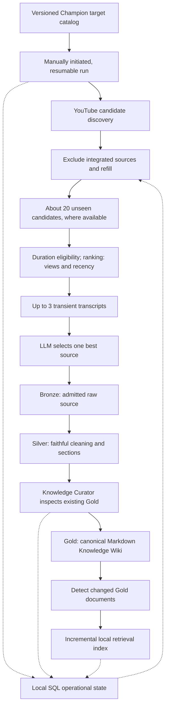
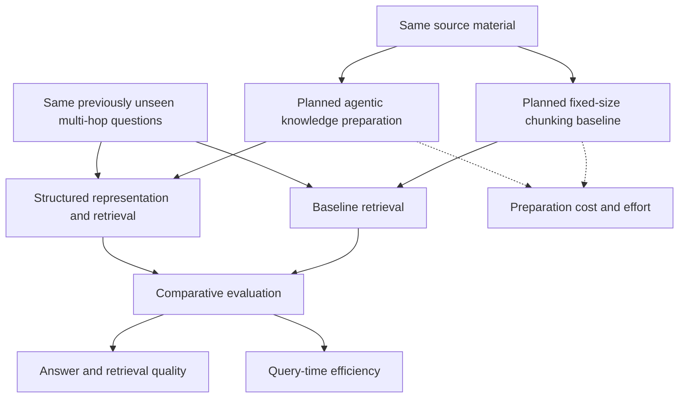

# Architecture

The Knowledge Platform is the acquisition and preparation side of an experiment on whether upstream agentic knowledge organization can reduce later multi-hop retrieval complexity and latency while preserving answer quality. League of Legends is the experimental domain. The hypothesis is unproven; the planned experiment supplements the accepted architecture below.

## V1 acquisition and compilation flow

This diagram describes the accepted end-to-end V1 design, not a completed pipeline. Implemented components are the Champion catalog, discovery, integrated-source SQLite lookup, unseen filtering/refill, deterministic ranking, and transient English transcript acquisition. Manually initiated resumable-run orchestration, LLM selection, Bronze/Silver, curation, Gold, and index synchronization remain planned. The implemented source catalog covers integrated IDs, not all the operational SQL responsibilities shown below.

The initial target catalog is a versioned, machine-readable local list of all Champions. It does not enumerate Champion × Role combinations. A manually initiated logical run attempts every configured target, may continue across batches or sessions, and integrates at most one new selected source per target. Later runs exclude sources already integrated. A Champion is never permanently complete. Role-specific and reusable general knowledge can emerge from content; systematic general-concept acquisition is future scope.

For each target, collection seeks 20 unique unseen YouTube candidates where available and returns at most 20, refilling search results after filtering integrated video IDs. Collection reports search exhaustion; recording it within a resumable run is planned. Duration is an eligibility filter only; deterministic ranking uses popularity and recency and returns up to three eligible candidates. Available English transcripts are acquired temporarily. The [implemented API documentation](../README.md#deterministic-candidate-ranking) describes the ranking formula and transcript provider. The planned LLM stage compares educational usefulness, relevance, information density, clarity, and noise to select one best source. Only the selected source will be admitted to Bronze.

## Knowledge layers and curator

These layers and curator responsibilities are planned. The intended curator comprises logical Knowledge Extraction and Knowledge Integration stages followed by a Deterministic Writer. Extraction progresses through SEGMENT, VALIDATE, EXTRACT, VALIDATE, AUDIT/REFINE, and VALIDATE to Knowledge Items. Structured artifacts pass explicit validation gates; failures return corrective feedback to the agent before progression. Integration inspects existing Gold and proposes governed changes; deterministic code applies validated, approved changes. This staged explanation preserves the existing curator boundary and does not establish a new runtime implementation or artifact schema. See [planned curation](../README.md#planned-agentic-knowledge-curation).

| Component | Responsibility | Durable output |
| --- | --- | --- |
| Bronze | Retain only the admitted source's raw transcript and available provenance. | Selected source material and source identity. |
| Silver | Remove reliably identifiable noise, clean and segment faithfully, and retain timestamps and deterministic provenance. | Source-aligned logical sections without synthesized knowledge or semantic chunk labels. |
| Knowledge Curator | Process one Silver source at a time after inspecting relevant existing Gold knowledge. | Governed changes or a recorded no-change outcome. |
| Gold | Maintain current structured League knowledge in an adaptive, versioned Markdown Knowledge Wiki. | Canonical knowledge with provenance and visible contradictions. |

The curator may apply NO_CHANGE, ENRICH, REWRITE, CREATE, MERGE, LINK, or FLAG_CONFLICT. It favors enriching equivalent knowledge over duplication and does not autonomously DELETE knowledge in V1. Source and operational metadata in Bronze and Silver remain deterministic; this restriction does not prevent semantic knowledge in Gold or transcript-based LLM source selection.

## Local state and retrieval boundary

The implemented SQLite catalog stores only integrated source IDs and their registration timestamps. Registration is idempotent and must follow successful Bronze persistence by a later caller; it does not implement Bronze itself. Collection reads a fixed integrated-ID snapshot and does not persist transient candidates.

The planned wider local SQL store tracks logical runs and progress, per-target results, raw knowledge-change counts, and Gold index synchronization state. Raw counts will support comparison of marginal knowledge gain across repeated runs; V1 has no synthetic aggregate score or automatic stop threshold. Schemas for those additional responsibilities remain future technical design work.

The planned local retrieval/vector index serves the Gold Wiki but is not authoritative. Changed Gold documents are re-chunked and re-embedded, their vectors are upserted, stale vectors are removed where applicable, and synchronization state is updated. A full rebuild after each curation run is not required. No vector database product is mandated.

The V1 design runs locally with filesystem Bronze/Silver/Gold artifacts and local operational and retrieval stores. External source/search and LLM APIs are used where needed. Azure infrastructure and Azure AI Search are not V1 requirements; Azure remains a possible later deployment direction.

## Planned comparative evaluation

The experiment will compare conventional fixed-size chunking plus retrieval with agentic preparation of more structured knowledge. Both paths will use the same source material and the same previously unseen multi-hop questions. The baseline, query-time comparison, and full evaluation are not implemented. This conceptual diagram supplements the acquisition and compilation architecture; it does not replace it or imply that either approach wins.

The evaluation will ask whether additional preparation reduces query-time complexity and latency without sacrificing answer quality. Planned dimensions include answer correctness, completeness, groundedness and relevance; retrieval recall, precision and source coverage; latency, retrieval/tool calls and reasoning steps; and preparation cost, agent iterations, validation failures, knowledge changes per source and marginal knowledge gain. These are intended measurements, not completed results or a defined benchmark protocol. See the [evaluation overview](../README.md#experimental-evaluation).

## System context and decisions

The separate Voice Coach can later retrieve Gold knowledge and reason over the player's manually supplied game context while maintaining current-game session state. A separate evaluation system can assess retrieval and coaching quality as well as repeated-run knowledge gain. Automatic patch awareness, live game-state reading, and persistent cross-game memory are outside initial V1.

The decisions and superseded assumptions are recorded in the public ADRs: [medallion layers](adr/001-medallion-architecture.md), [Silver source alignment](adr/002-source-aligned-chunks.md), [superseded Azure index](adr/003-single-search-index.md), [source metadata](adr/004-minimal-deterministic-metadata.md), [local-first V1](adr/005-local-first-v1.md), [iterative acquisition](adr/006-iterative-champion-acquisition.md), [source selection](adr/007-two-stage-source-selection.md), [canonical Gold](adr/008-canonical-gold-wiki.md), [operational state](adr/009-local-state-and-knowledge-gain.md), and [incremental retrieval](adr/010-incremental-gold-retrieval-index.md).
