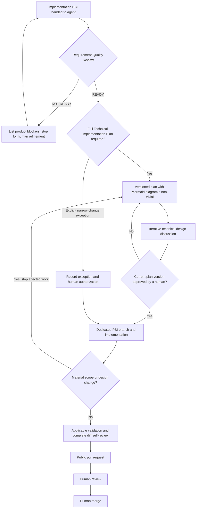

# Development workflow

Development is human-supervised: agents prepare plans, implement approved changes, validate their work, and explain the result. Humans approve the design and retain final pull-request review and merge authority.

## Requirements and public documentation

Azure DevOps is the private source of truth for feature requirements, Product Backlog Items (PBIs), and acceptance criteria. Repository documentation explains the public scope, architecture, decisions, and development process; it does not duplicate the private backlog.

Read the relevant feature, PBI, and acceptance criteria alongside [V1 scope](scope.md), [architecture](architecture.md), and the [ADRs](adr/). Perform the separate Requirement Quality Review before Technical Planning whenever an implementation PBI is handed to an agent. Resolve missing or inconsistent product requirements with a human in the private planning context; do not infer approval or invent requirements.

Keep detailed plans, private requirements, discussions, and sensitive validation evidence in Azure DevOps or an authorized private task conversation. Updating Azure DevOps requires explicit task authorization. Public branches, files, commits, and PRs must contain only information approved for publication. A PBI reference is suitable for public traceability only if GitHub does not expand it into a private URL; otherwise give the reference to the authorized reviewer privately.

## PBI Definition of Ready

A PBI is ready for Technical Planning when:

- objective is clear
- scope is sufficiently bounded
- acceptance criteria are testable
- relevant constraints are documented
- blocking dependencies are identified
- no unresolved product-level ambiguity requires assumptions

Technical implementation choices are intentionally not prerequisites for readiness unless the PBI explicitly constrains them.

## Workflow

For an explicitly allowed narrow-change exception, the full plan is omitted, but Requirement Quality Review and applicable human authorization still precede implementation.

## 0. Perform the separate Requirement Quality Review

This review is mandatory for every implementation PBI handed to an agent, including a narrow documentation or mechanical change that may later skip the full Technical Implementation Plan. Return exactly one outcome:

- **READY:** the objective and scope are clear, acceptance criteria are testable, relevant constraints and blocking dependencies are identified, and no unresolved product-level ambiguity requires an assumption.
- **NOT READY:** list every missing, ambiguous, contradictory, or non-testable product requirement and explain why it blocks Technical Planning. Do not propose product defaults, resolve the requirement on the human's behalf, create an implementation plan, or implement. Stop until the PBI is refined.

Module structure, interfaces, libraries, dependency injection, asynchronous implementation, internal abstractions, and file organization are technical design choices for planning unless the PBI explicitly constrains them. They are not missing product requirements.

## 1. Prepare an implementation plan

After `READY`, every non-trivial implementation PBI requires an agent-generated Technical Implementation Plan before implementation. Behavior changes, integrations, dependencies, architecture decisions, data migrations, and work spanning multiple components are non-trivial. Narrow documentation, typo, or mechanical changes with no behavior or design impact may skip the full plan only where explicitly allowed; they never skip the Requirement Quality Review. Ambiguous cases require human classification.

Identify each plan version explicitly as `v1`, `v2`, and so on. Include at least one useful Mermaid diagram in every non-trivial plan; add sequence, state, component, or data-flow diagrams when they improve the design discussion. The human and agent may iterate through multiple versions before approval.

The plan should cover, where applicable:

- Objective, scope, non-goals, and a mapping from acceptance criteria to the proposed design and validation.
- Proposed architecture; component responsibilities; data flow; interfaces and contracts; data models; external dependencies; configuration; and error handling or failure behavior where applicable.
- Affected modules and files, alternatives and tradeoffs, and applicable tests and validation.
- Risks, compatibility or data effects, rollback considerations, open technical questions, and proposed deviations from accepted architecture where relevant.

Keep the plan and its versions in the private planning context. Inspecting the repository and gathering requirements can proceed during planning; implementation waits for the applicable human design approval.

## 2. Obtain human design approval

A human reviews the current plan version, discusses and resolves technical questions with the agent, and explicitly approves that specific version. Record the version identifier and its approval in the private task context so the implementing agent can verify them. An initial assignment, permission to inspect the repository, silence, or another agent's review does not satisfy this gate.

If approval is missing, the agent stops before implementation and presents the current version for review. If implementation reveals a material change to scope or design, stop affected work, create a revised plan version (`v2`, `v3`, etc.), and obtain renewed explicit human approval of that version before continuing. Approval of an earlier version does not carry over. This design review is separate from final PR review.

For an explicitly allowed narrow-change exception, record why the full plan is unnecessary and obtain explicit human authorization for the described change. If the change becomes material, stop affected work and create a versioned plan for human approval.

## 3. Implement on a dedicated PBI branch

Create a dedicated branch from an up-to-date `main` using `pbi-<id>-<short-description>`, with a short, public-safe description. Keep each branch focused on its PBI and preserve unrelated local work. Do not implement directly on `main`.

Follow the approved plan and [repository agent instructions](../AGENTS.md). Keep changes small enough to review, stay within the accepted V1 scope and ADRs, and update relevant documentation when behavior or design changes. Record deviations and follow-up work in the private task context; material deviations return to design review.

## 4. Validate and self-review

Before opening a PR, the agent runs applicable automated tests, linting, builds, and other checks available for the changed components. Validate relevant acceptance criteria and inspect the full diff for correctness, regressions, scope, architecture consistency, and accidental disclosure of private information or secrets.

Report the commands run, their results, and any failures, unavailable tooling, or checks not performed. Resolve findings before handing off, or clearly identify unresolved blockers. Never describe a planned or unrun check as passing.

The repository contains Python acquisition components and offline unit/integration tests, run with `python -m unittest discover -s tests -v`. Install `requirements-transcripts.txt` to include the offline SDK adapter tests; without those optional dependencies, those tests explicitly skip. No CI workflow is currently configured. Documentation changes require checking Markdown/Mermaid rendering where applicable, relative links, consistency with the scope and ADRs, implemented/planned status, and diff whitespace. This process establishes review expectations; it does not itself install CI or configure branch protection.

## 5. Prepare the public pull request

The default delivery for completed PBI work is to commit the validated changes, push the dedicated PBI branch, and open a PR using the [PR template](../.github/pull_request_template.md). Give the human reviewer the PR link and leave final review and merge to them. Honor explicit local-only, no-commit, or no-push instructions: provide the local diff and validation results and stop at that delivery boundary.

The public PR description should stand on its own and include:

- Objective, scope, and explicit exclusions where useful.
- A publication-safe PBI reference, if one can be shown without exposing an internal URL, and a public-safe summary of relevant acceptance criteria.
- Implementation approach, confirmation that the separate Requirement Quality Review returned `READY`, and the approved plan version or explicit narrow-change exception. Note renewed approval for a materially revised version where applicable.
- Validation performed, results, and any limitations or blockers.
- Deviations from the approved plan and identified follow-up work, or an explicit statement that there are none.

Summarize criteria rather than copying private Azure DevOps text. If a criterion cannot be disclosed publicly, state that its validation evidence is available to the authorized human reviewer in the private planning context. Do not imply that public summaries replace the authoritative criteria. Avoid internal URLs, detailed private plans, discussion transcripts, and credentials.

## 6. Human PR review and merge

A human performs the final PR review, checks the result against the authoritative acceptance criteria and validation evidence, and decides whether to merge. Agent self-review and passing automated checks support this decision; they do not replace it. Agents must not approve their own PRs or merge them.

Address review feedback and rerun checks affected by subsequent changes. Return material scope or design changes to the earlier approval gate. Humans retain control over merge and work-item completion; agents update Azure DevOps only when explicitly authorized.
